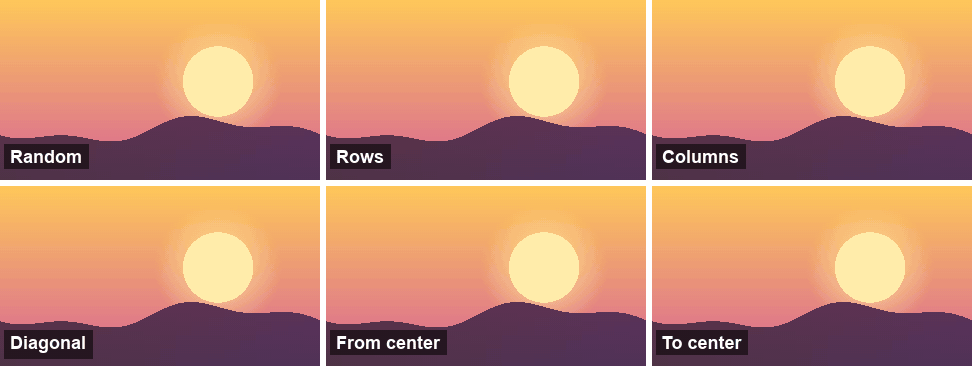

# BC©Grid

**A grid transition for Adobe Premiere Pro on Windows, by BillyCreative.**

Drop it between two clips: the frame splits into a grid of tiles and each tile flips to the next
shot at its own moment, with thin grid lines and a quick glow as each tile turns over.

<p align="center">
  
</p>

## Six reveal patterns

<p align="center">
  
</p>

| Pattern | What happens |
|---|---|
| **Random** | Tiles flip in a random order. Change the seed for a different order |
| **Rows** | Row by row, left to right, top to bottom |
| **Columns** | Column by column, top to bottom, left to right |
| **Diagonal** | A wave from the top-left corner to the bottom-right |
| **From center** | Starts in the middle and spreads out to the edges |
| **To center** | Starts at the edges and closes in on the middle |

## Download and install

1. Go to **[Releases](../../releases/latest)** and download **`BC_Grid_Setup.exe`**.
2. Close Premiere Pro.
3. Run `BC_Grid_Setup.exe` and click through (it asks for administrator permission).
   If Windows says *"Windows protected your PC"*, click **More info → Run anyway**. The installer is
   not code-signed, so Windows shows this for any small publisher.
4. Open Premiere Pro, then drag **Video Transitions → BillyCreative → BC©Grid** onto the cut between
   two clips.

A one-page install guide (PDF) is attached to every release too.

**Without the installer:** download `BCGrid.aex` from the release and copy it to
`C:\Program Files\Adobe\Common\Plug-ins\7.0\MediaCore\BillyCreative\` (create the folder), or run
`install.bat` from the release as administrator.

**Uninstall:** Windows Settings → Apps → *BC©Grid (BillyCreative)* → Uninstall.

### Requirements

- Windows 10 or 11, 64-bit (Intel or AMD)
- Adobe Premiere Pro 2022 or newer. It also works in After Effects (see below)

### Using it in After Effects

1. Put two clips in a comp, one layer above the other, and select the top layer.
2. In **Effects & Presets**, search **BC©Grid** and double-click it.
3. Set **Second clip** to the other layer and hide that layer (eye icon).
4. Keyframe **Progress** from 0 % to 100 %.

## Settings

Select the transition on the timeline and open **Effect Controls**:

| Setting | Default | What it does |
|---|---|---|
| Columns / Rows | 3 / 3 | Grid size, 1 to 100 each way |
| Grid lines: Show | on | Draws the grid lines |
| Line thickness (px) | 4 | Line thickness |
| Line color | black | Line colour |
| Pattern | Random | The order the tiles flip in (see above) |
| Random seed | 1 | Shuffles the random order |
| Flash: On | on | Glow on each tile as it flips |
| Flash color | white | Glow colour |
| Flash intensity | 80 % | Glow strength |
| Flash length (frames) | 4 | How many frames the glow lasts |
| Progress | 0 % | Only for After Effects, where you keyframe it from 0 % to 100 %. In Premiere the transition runs by itself over its length |
| Second clip | — | Only for After Effects: the layer to reveal. Premiere fills it in for you |

Change the transition's length on the timeline to make it faster or slower. 8-bit and 16-bit
sequences are supported.

Projects move freely between Mac and Windows: the macOS version uses the same internal name and
settings, so a cut made on one opens on the other with the transition and its settings kept.

## Troubleshooting

- **It's not in Video Transitions:** make sure Premiere was closed while installing, then restart it.
  If it still isn't there, check that `BCGrid.aex` is in the folder above.
- **The installer won't start:** right-click it → Properties → tick **Unblock** → OK, then run it again.

---

## For developers

The plugin is plain C++ on Adobe's effect SDK.

| Path | What |
|---|---|
| `src/BCGridCore.h` | Tile order and drawing, no Adobe types (portable and testable) |
| `src/BCGrid.cpp` | Effect entry point, settings, Premiere transition hookup |
| `src/BCGridStrings.h` | UI text |
| `src/BCGridPiPL.r` | Plugin resource (contains a raw 0xA9 byte; keep the encoding) |
| `installer/` | Inno Setup script (English) and `install.bat` |
| `test/render_test.cpp` | Self-checks for the core |
| `test/make_preview.cpp` | Renders the preview frames used above |

**Test the core** with any C++17 compiler:

```
c++ -std=c++17 -O2 -Isrc test/render_test.cpp -o render_test && ./render_test .
```

**Build on Windows:** install *Build Tools for Visual Studio 2022* (Desktop development with C++),
unzip Adobe's After Effects SDK into `sdk\` (see [sdk/README.md](sdk/README.md)), run `build.bat`,
then compile `installer\BCGrid.iss` with Inno Setup 6.3+.

The GitHub Actions workflow builds the plugin and installer on every push and publishes them when a
`v*` tag is pushed. The SDK comes from a private source, because Adobe does not allow it to be
redistributed.

© 2026 BillyCreative. All rights reserved.
